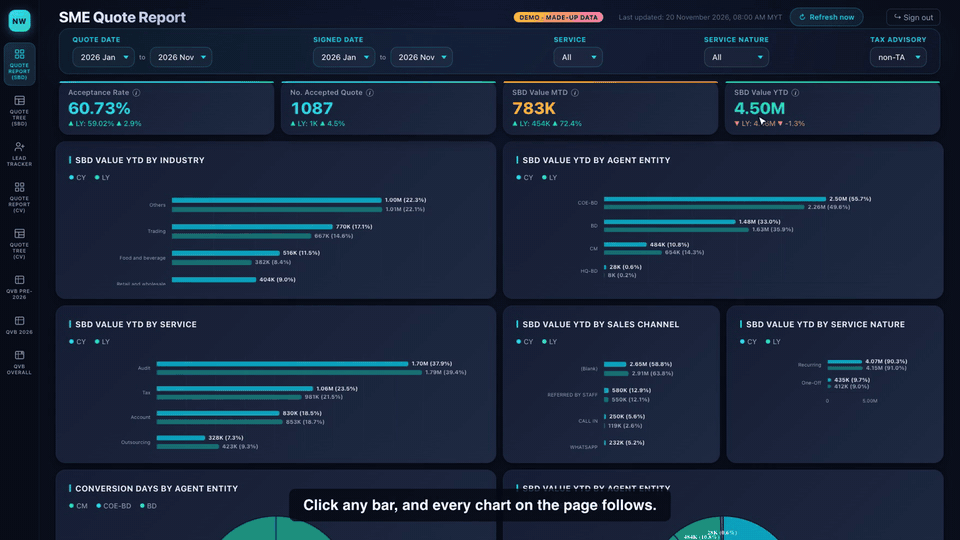
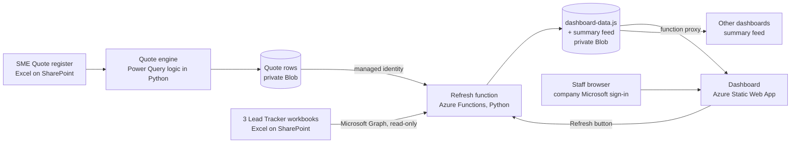
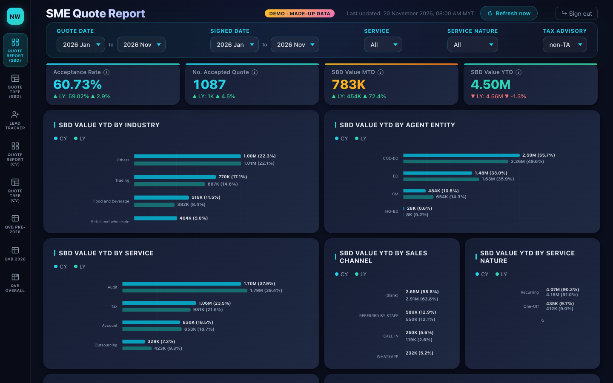
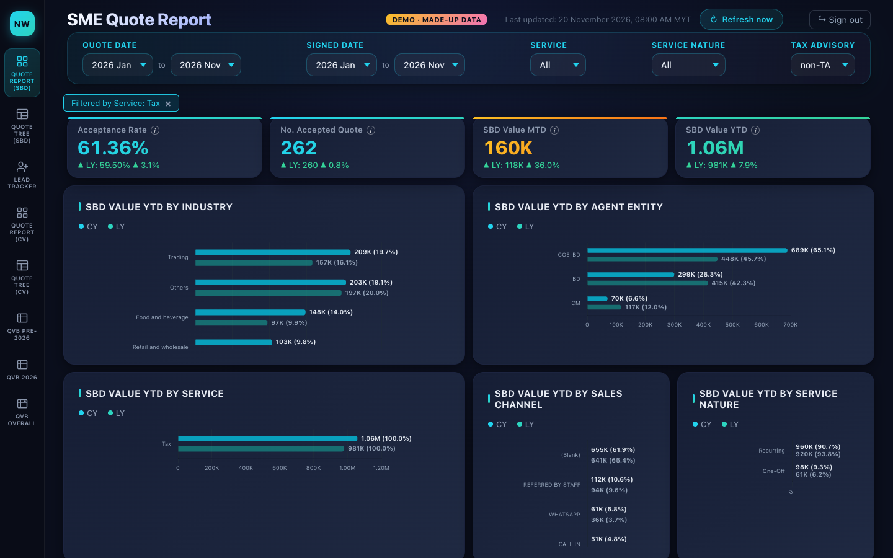
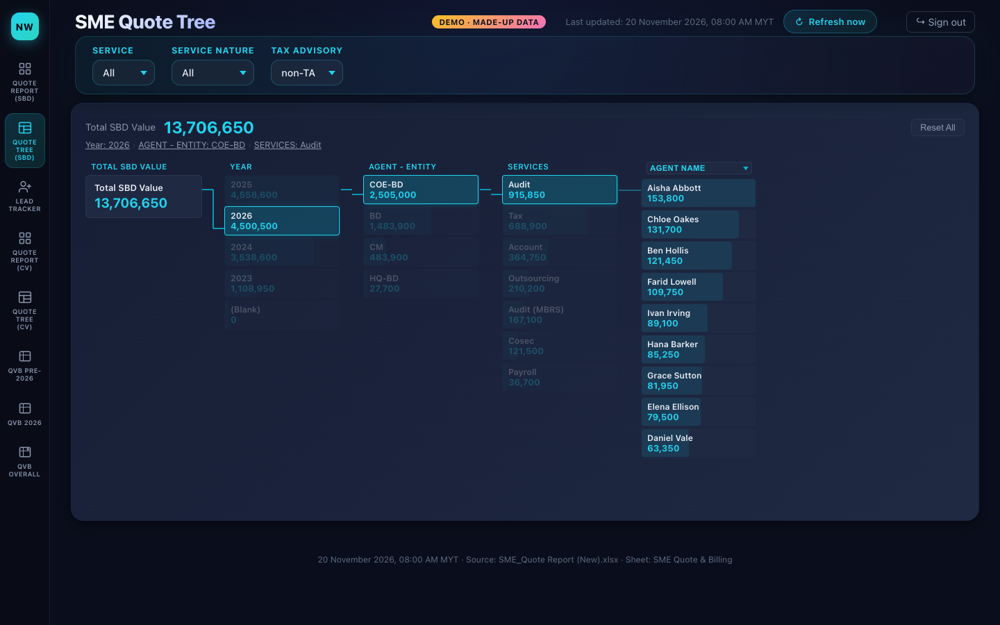
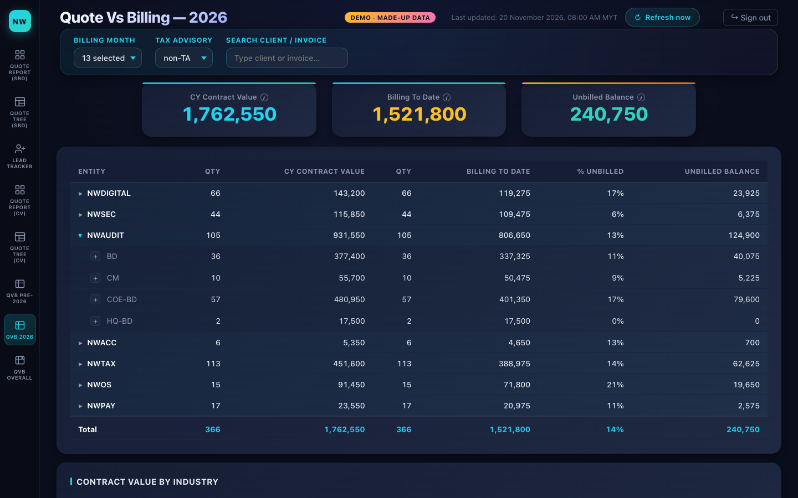
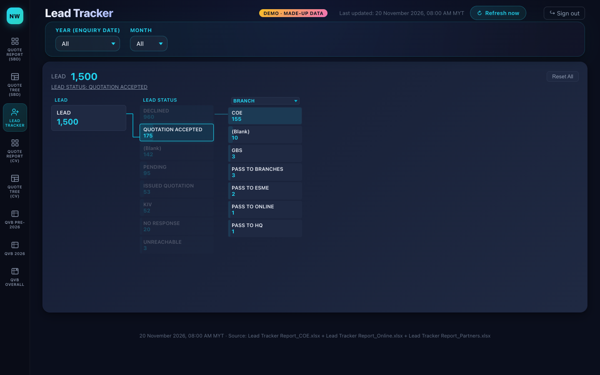
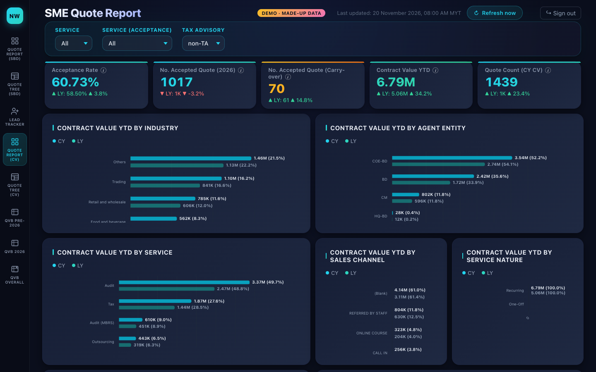

# SME Quote Dashboard: quotes, sign-backs and billing for an advisory firm's sales team, as a secure Azure web app

The sales and management team of a Malaysian accounting and advisory firm use it to see which quotes came back signed, how this year compares with last, where each ringgit of signed value came from, and how much contracted work is still to be billed. It replaced a Power BI report that every viewer needed a licence for, and that was rebuilt by hand from one Excel register.
In use since May 2026.

Charts were the easy part. This page explains **how the pieces fit together**: where the data comes from, how one button rebuilds it, who can see it, and how it stays private.

> **About the data:** every number, company and person on this page, in the video and in the demo is made up (a fictional "Northwind Advisory Group"). The real dashboard runs on the firm's own data and is private.

| | |
|---|---|
| 🖱️ **[Try the demo](https://trisglenanne9.github.io/sme-quote-webapp/)** | the real front end with made-up data, in your browser, no login |
| 🎬 **[Watch the 1-minute video](docs/video/sme-quote-dashboard-720p.mp4)** | what it does and how it is built ([captions](docs/video/captions.srt)) |
| 📘 **[User guide](docs/GUIDE.md)** | every view, filter and definition |
| 🛠️ **[Technical architecture](docs/ARCHITECTURE.md)** | the same design in developer detail |

## See it working

## How it works

| Source | What it holds | How it's read | How often |
|---|---|---|---|
| SME Quote register (via the quote engine's output) | every quote and task line: client, service, agent, quote and signed-back dates, SBD value, contract value, billing month, billed and remaining amounts | Azure Blob, system-assigned managed identity | on every Refresh |
| Lead Tracker workbooks (3 files) | every enquiry: status, branch, source, enquiry date | Microsoft Graph, app permission limited to one SharePoint site | on every Refresh |

## The problem it solves

Quotes were reported from a Power BI file built on the sales team's Excel register. Everyone who opened it needed a Power BI licence, the figures were only as fresh as the last time someone refreshed it by hand, and the rules behind each number were buried in measures few people could read.

## The design choices, in plain terms

| Choice | Why it matters |
|---|---|
| **Leave the sales team's spreadsheets where they are** | Nobody re-types data and there is no second copy to keep in step. The app only ever *reads* the files. |
| **Reuse the quote engine instead of re-parsing Excel** | The register's Power Query logic (which row carries the contract value, how billing is allocated) lives in one place, so this dashboard and the firm's other quote reports always agree. |
| **Refresh on demand, not on a timer** | One button rebuilds everything in about a minute. Nothing runs while nobody is looking, so it costs almost nothing to run and there are no Power BI licences. |
| **Do the maths in the browser** | The page receives every row once, then each filter, cross-filter and drill-down is calculated instantly on the user's machine, without another round trip. |
| **Keep the data locked away** | The storage has no public door: the page reads its data through the function, which checks a key. Only company Microsoft accounts get in; personal accounts and other domains are turned away, and Sign out also ends the Microsoft session. |
| **Least privilege everywhere** | The app can read one SharePoint site and nothing else, and reads the quote rows with its own managed identity rather than a shared password. |
| **Fail safe** | Two refreshes can't collide (a lock file). An optional lead source that is missing or not yet shared is skipped, not fatal. A refresh that finds no rows stops and keeps the previous file. |

## How it stays right

- **Same rules as the report it replaced.** Every KPI was rebuilt from the Power BI measures, and each one carries an ⓘ that shows its exact formula on the page.
- **One row source for every view.** All eight views are projections of the same row set, so a figure on Quote vs Billing and the same figure in the Quote Tree cannot drift apart.
- **Shows its age.** The header says when the data was last rebuilt; after a refresh it says "Last refreshed: just now".
- **Says when something broke.** The Refresh reply lists how many leads came from each source, so a silent permission problem shows up as a zero instead of hiding in the logs.

## What it shows

- **Quote Report (SBD):** acceptance rate, accepted quotes and signed-back (SBD) value this month and year to date, against last year, by industry, agent entity, service, sales channel and service nature.
- **Quote Tree (SBD):** where the signed-back value came from, one click at a time (year → agent entity → service → agent → client …), always suggesting the most telling next split.
- **Lead Tracker:** enquiries by status, branch and source across the three lead channels.
- **Quote Report (CV) and Quote Tree (CV):** the same questions for annual contract value.
- **Quote vs Billing (before 2026, 2026, overall):** contract value, billed to date and still to bill, by entity, agent and client, with a client or invoice search.

## Screens

<table>
<tr>
<td width="50%"><b>Quote Report</b>: this year against last </td>
<td width="50%"><b>Click to filter</b>: click "Tax" and every chart follows </td>
</tr>
<tr>
<td><b>Quote Tree</b>: 2026 → agent entity → service → agent </td>
<td><b>Quote vs Billing</b>: contracted, billed and still to bill, by entity </td>
</tr>
<tr>
<td><b>Lead Tracker</b>: enquiries by status and branch </td>
<td><b>Quote Report (Contract Value)</b> </td>
</tr>
</table>

More in the [user guide](docs/GUIDE.md).

## Tech stack

| Part | Built with |
|---|---|
| Data pipeline | Python 3.11 on Azure Functions (Flex Consumption), openpyxl, MSAL, Microsoft Graph |
| Storage | Azure Blob Storage (private container) |
| Front end | one HTML page, vanilla JavaScript, Chart.js 4 |
| Hosting & sign-in | Azure Static Web Apps, Microsoft Entra ID |
| Identity | Entra app registration with Graph `Sites.Selected`; system-assigned managed identity for storage |
| Deploy | Azure Functions Core Tools, Static Web Apps CLI, PowerShell |

## By the numbers

| | |
|---|---|
| Views | 8 |
| Data sources | 4 files (1 quote register + 3 lead trackers) |
| Records | about 7,000 quote lines and 1,600 leads |
| Refresh | on demand, about 1 minute |
| Running cost | pay per use: the functions scale to zero, the Static Web App is on the Free plan, no Power BI licences |

## Made by

**trisglenanne9**, with Claude Code as an AI pair programmer.
