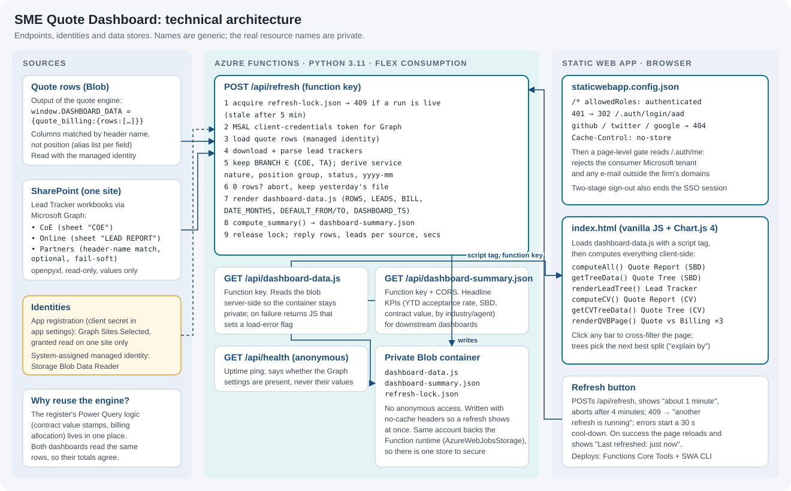

# SME Quote Dashboard: technical architecture

[← Back to the overview](../README.md) · [User guide](GUIDE.md)

> Resource names, hostnames, keys and tenant details are left out on purpose. Every value shown in the demo is made up.

## 1. The constraint that shapes it

The sales team keeps working in Excel on SharePoint, and that must not change. Everything else follows: the app **reads** the register and the lead trackers and never writes to them, so there is no second copy to keep in step and no new process for anyone to learn.

The second constraint is data protection: quote and billing data is client data. It stays inside the firm's own Microsoft tenant, behind the company sign-in, in storage with no public access.

## 2. Where everything runs

| Box | Runs on | Job |
|---|---|---|
| SME Quote register | SharePoint Online | the sales team's master list of quotes and task lines |
| Lead Tracker workbooks (3) | SharePoint Online | enquiries from three lead channels |
| Quote engine | Azure Functions (a separate, earlier project) | turns the register's Power Query logic into Python and writes clean quote & billing rows to its own private Blob |
| Refresh function | Azure Functions, Python 3.11, Flex Consumption | rebuilds this dashboard's data file on demand |
| Private Blob container | Azure Storage | `dashboard-data.js`, `dashboard-summary.json`, `refresh-lock.json` |
| Dashboard | Azure Static Web Apps (Free plan) | one HTML page with eight views; Entra ID sign-in |
| Downstream dashboards | elsewhere in the tenant | read the summary feed with their own key |

## 3. Data sources

| Source | Owner | Access | Refreshed | Size | Known quirks |
|---|---|---|---|---|---|
| Quote rows (from the quote engine) | sales team, via the register | `ManagedIdentityCredential`, role *Storage Blob Data Reader* | each Refresh | ~7,000 task lines | wrapped as `window.DASHBOARD_DATA = {quote_billing:{rows:[…]}}`; columns are matched **by header name** through an alias list, so a renamed or moved column fails loudly with the list of headers found, instead of silently shifting |
| Lead Tracker: CoE | CoE team | Microsoft Graph, app-only, `Sites.Selected` on one site | each Refresh | ~1,150 leads | positional columns; status in column 36 |
| Lead Tracker: online channel | channel team | same | each Refresh | ~450 leads | a different layout: status is one column earlier than in the CoE file |
| Lead Tracker: partners | partner channel | same | each Refresh | a handful | located **by header name**, not position; optional and fail-soft (missing file or a 403 is logged and skipped) |

Why the managed identity is created explicitly: the Function App also carries the Graph app's client ID and secret in its settings. `DefaultAzureCredential` would pick those up and try to read storage as the Graph app, which has no storage role. `ManagedIdentityCredential` avoids that.

## 4. Pipeline

`POST /api/refresh` (function key):

| Step | What it does | What it guarantees |
|---|---|---|
| Lock | writes `refresh-lock.json`; a second caller gets **409** | two refreshes never interleave; a lock older than 5 minutes is treated as stale, so a crash can't block refreshes forever |
| Authenticate | MSAL client-credentials token for Graph | no user credentials are involved |
| Extract | quote rows from Blob; lead workbooks through Graph (`openpyxl`, read-only, values only) | the sources are never modified |
| Clean | keep branch COE / TA (case-insensitive); dates to `YYYY-MM`; derive service nature (one-off vs recurring), position group, status (Accepted / Declined / Cancel / Pending) | one vocabulary for every view |
| Combine | rows + leads + a per-quote billing index `BILL[quote] = [[month, billed, remaining], …]` | |
| Guard | zero quote rows → abort | an empty or broken source never replaces good data |
| Store | `dashboard-data.js` (all rows + month list + default YTD range + timestamp); `dashboard-summary.json` (headline KPIs) — both with `no-cache` headers | the next page load sees the new data immediately |
| Report | releases the lock; replies with row count, **leads per source** and seconds taken | a silent permission failure shows up as a zero |

## 5. Data model & definitions

One row per **task line** of a quote. The fields the page uses:

| Field | Meaning |
|---|---|
| `eq` | entity quote, `"<quote no>/<n> <ENTITY>"`; distinct `eq` = one quote |
| `qd`, `sb` | quote month and signed-back month (`YYYY-MM`); `yr` and `mn` come from `sb` only |
| `st` / `status` | quote state; anything other than Accepted, Declined or Cancel counts as Pending |
| `sbd` | signed-back (SBD) value of the task line |
| `cycv`, `lycv` | this year's / last year's contract value, stamped on **one** row per quote upstream, so summing never double-counts |
| `bm`, `bil`, `rtb` | billing month, amount billed, remaining to bill |
| `ind`, `ag`, `svc`, `cy`, `sc`, `sn`, `src`, `an`, `pos`, `pbl`, `cl` | industry, agent entity, service, service-by-cycle, service cycle, service nature, sales channel, agent, position, position group, client |

The full KPI definitions are in the [user guide](GUIDE.md#definitions); each card also shows its formula behind the ⓘ.

## 6. Refresh & monitoring

- **Trigger:** the Refresh button on the page (no timer). The button shows "about 1 minute", gives up after 4 minutes, reports 409 as "another refresh is running", and starts a 30-second cool-down after an error.
- **Last refreshed:** every view shows the timestamp written into the data file; after a successful refresh the page reloads and says "Last refreshed: just now".
- **Logs:** Application Insights on the Function App.
- **Health:** `GET /api/health` (anonymous) answers whether the Graph settings are present, never their values, for uptime monitors.

## 7. Hosting & access

- `staticwebapp.config.json`: every route requires the `authenticated` role; a 401 redirects to `/.auth/login/aad`; the GitHub, Twitter and Google providers return 404; `Cache-Control: no-store` everywhere; only `logged-out.html` is public.
- A page-level gate then reads `/.auth/me` and turns away the Microsoft consumer tenant (personal accounts) and any e-mail outside the firm's domains, before anything is drawn.
- **Two-stage sign-out:** Static Web Apps' `/.auth/logout` only clears its own cookie, so the page bounces through `logged-out.html` to the Microsoft logout endpoint and ends the single-sign-on session too. In-memory rows are wiped before navigating.

## 8. Security & privacy

| Risk | Control |
|---|---|
| Data read by anyone with the URL | Blob container is private; the page loads data through `/api/dashboard-data.js`, which reads the blob server-side and requires a function key. (An earlier version read a public blob; this was closed.) |
| Over-broad SharePoint access | Graph `Sites.Selected`, granted read on one site only |
| Shared passwords for storage | system-assigned managed identity with a read-only role |
| Secrets in code | client secret lives in Function App settings; nothing secret is in the repository |
| Wrong people signing in | Entra ID + tenant and domain check + no social providers |
| Stale data after sign-out | `no-store` caching; rows cleared on sign-out |

## 9. How accuracy is checked

- **Parity with the report it replaced.** The KPIs were rebuilt from the Power BI measures, including the less obvious ones: acceptance rate counts quotes issued last year but signed back this year in both numerator and denominator; contract value is summed only where it is stamped; Quote vs Billing includes Draft and Pending quotes that carry a contract value, exactly as the old visuals did.
- **One source for every view.** All eight views are projections of the same `ROWS`, so the trees, cards and tables reconcile by construction.
- **Column-drift guard.** A missing column stops the refresh with the list of headers found.
- **Field-level notes** were kept for the trickiest numbers (for example the three Quote vs Billing cards), so a future change can be checked step by step.

## 10. Design decisions

| Decision | Why | Rejected |
|---|---|---|
| Static page + on-demand function | cheap, fast, nothing to patch, works on the Free plan | an always-on web server |
| Compute KPIs in the browser | instant filters and drill-downs on ~8,000 rows; the back end stays a simple data mover | server-side query per click |
| Reuse the quote engine's rows | one implementation of the register's Power Query logic | parsing the 7 MB workbook a second time |
| Azure-direct hosting | on-demand, all inside the tenant, logs in Application Insights | an earlier GitHub Actions + Pages version (scheduled, laggy, harder to debug) |
| Vanilla JS + Chart.js | no build step; one file to deploy | a SPA framework |
| Refresh button, not a schedule | data changes when the sales team updates the register; people refresh when they need it | a nightly timer |

## 11. Known limits

- Desktop-first: on a phone the page works but needs horizontal scrolling.
- The lead trackers are read by column position (two of the three files); a re-ordered sheet needs a code change.
- "This year" follows the browser's clock, so the Quote vs Billing year tabs roll over on 1 January.
- The data file carries every row, so the page is a few MB on first load.

## About the demo

The [demo](https://trisglenanne9.github.io/sme-quote-webapp/) is the real `index.html` with the back end taken away: a build script swaps the data source for a made-up `dashboard-data.js`, removes the sign-in gate and every key and hostname, freezes the clock at 20 Nov 2026, replaces the real entity codes, and fails if any real name, domain or key is still in the page.
