# SME Quote Dashboard: user guide

[← Back to the overview](../README.md) · [Technical architecture](ARCHITECTURE.md)

> Every screenshot uses made-up data for a fictional "Northwind Advisory Group".

## 1. Who uses it and for what

- **Sales (business development) and management:** how many quotes were accepted, how much value was signed back this month and this year, and how that compares with last year.
- **Team leads:** which agents, services, industries and lead channels the signed value comes from.
- **Finance and management:** how much contracted work has been billed, and how much is still to bill, by entity, agent and client.

## 2. The routine

1. Open the dashboard and sign in with your company Microsoft account.
2. Check **Last updated** in the header. If the register or a lead tracker changed since then, press **Refresh now** and wait about a minute; the page reloads by itself.
3. Pick a view in the left sidebar. Filters at the top apply to that view only.
4. Click any bar to filter the whole page to it; click it again (or the × on the "Filtered by" chip) to clear.

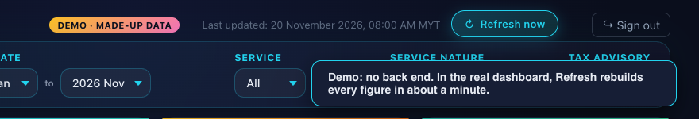

## 3. The views

### Quote Report (SBD)

**Answers:** how many quotes were accepted this year, how much was signed back this month and year to date, and how that compares with last year.

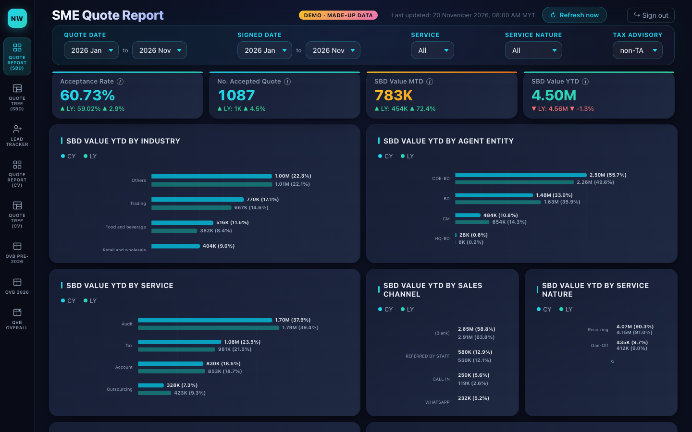

- **Four cards:** Acceptance Rate, No. Accepted Quote, SBD Value MTD, SBD Value YTD. The small line under each is last year's figure for the same months and the change.
- **Bar charts (this year vs last year):** SBD value by industry, agent entity, service, sales channel and service nature. Hover a bar to see both years.
- **Donuts:** conversion days and SBD value by agent entity.
- **Filters:** Quote Date range, Signed Date range, Service, Service Nature, Tax Advisory (non-TA by default).
- **Click to filter:** click any bar and every card and chart follows.

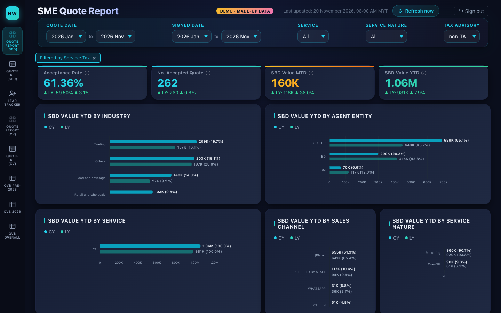
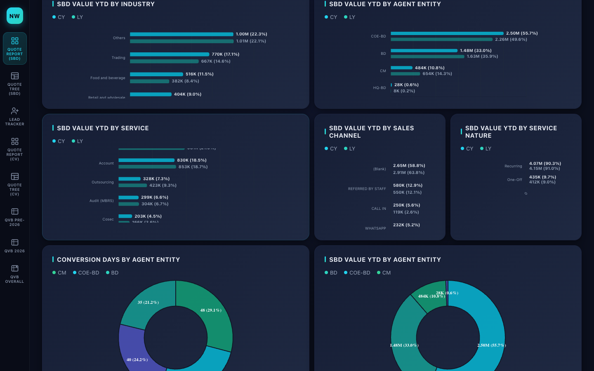

### Quote Tree (SBD)

**Answers:** where did the signed-back value come from?

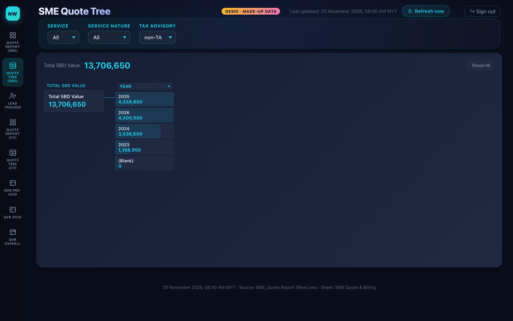

Start from the total, click a box to split it, and keep going. Each new column is chosen automatically as the split that explains the most (you can change it with the drop-down in the column header). The path you took is shown as links under the total; click one to step back.

Levels available: year, agent entity, services, agent name, industry, source, position, position group, referred by, client, and more.

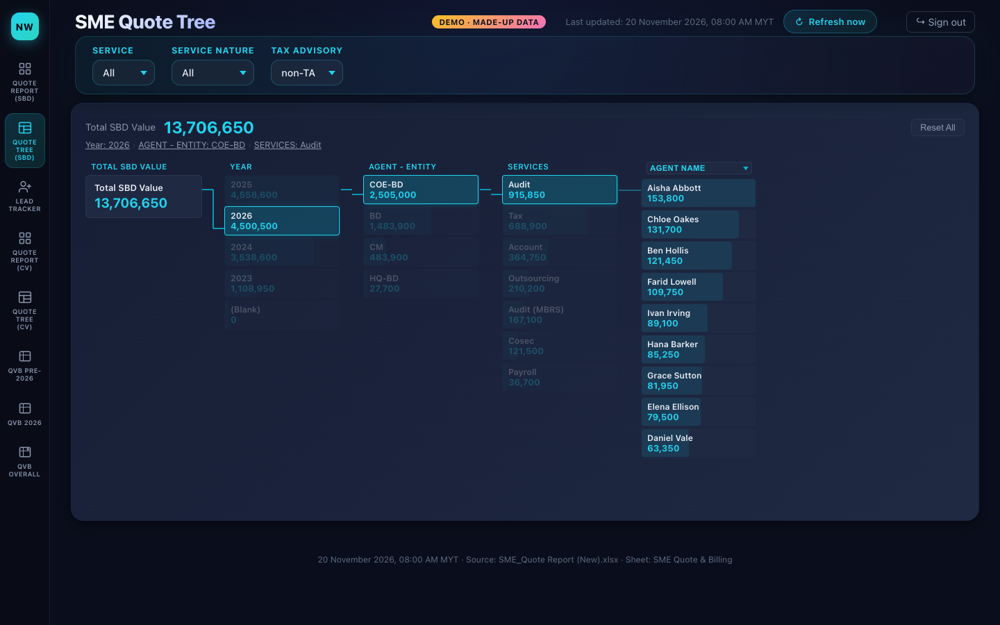

### Lead Tracker

**Answers:** how many enquiries came in, and what happened to them?

A tree of all leads from the three lead trackers, split by lead status, branch and source. Filter by enquiry year and month.

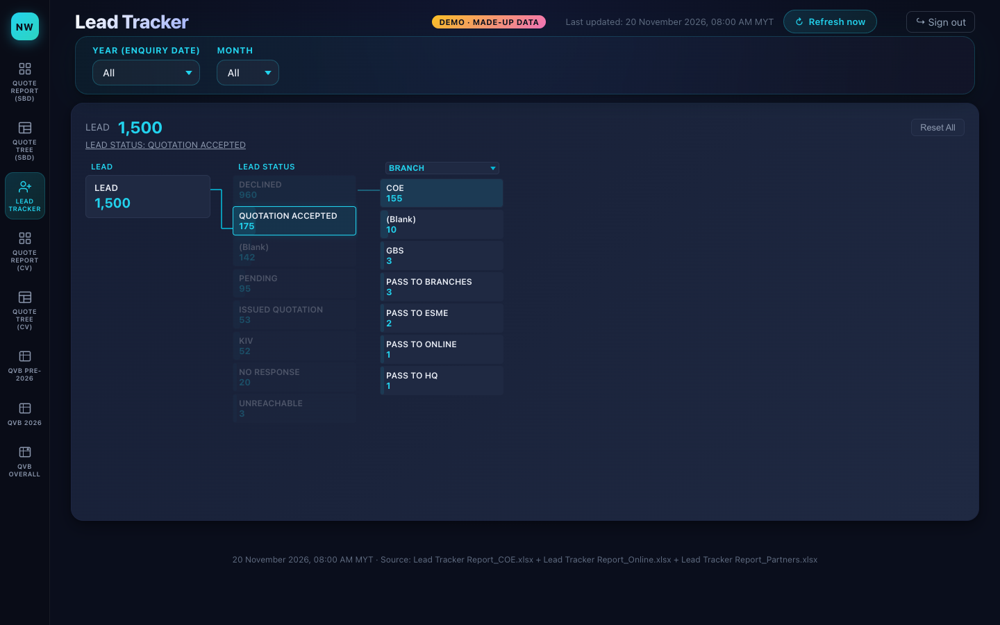

### Quote Report (CV) and Quote Tree (CV)

**Answers:** the same questions for annual **contract value** instead of signed-back value: how much recurring work was contracted this year against last, and from where.

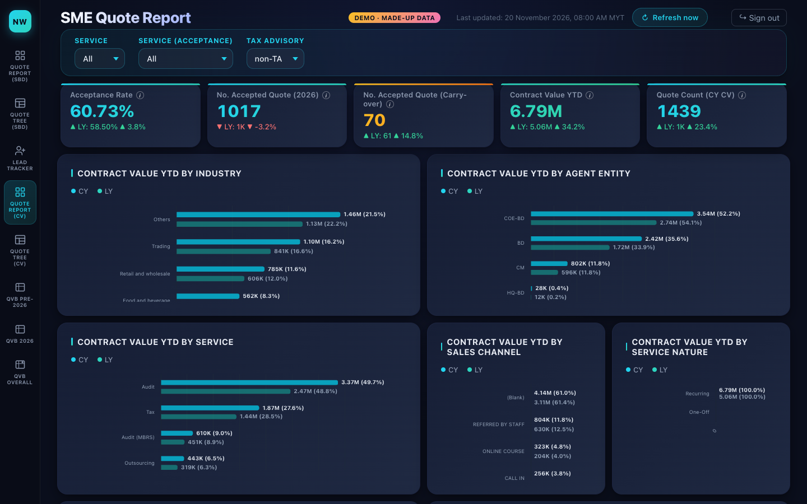
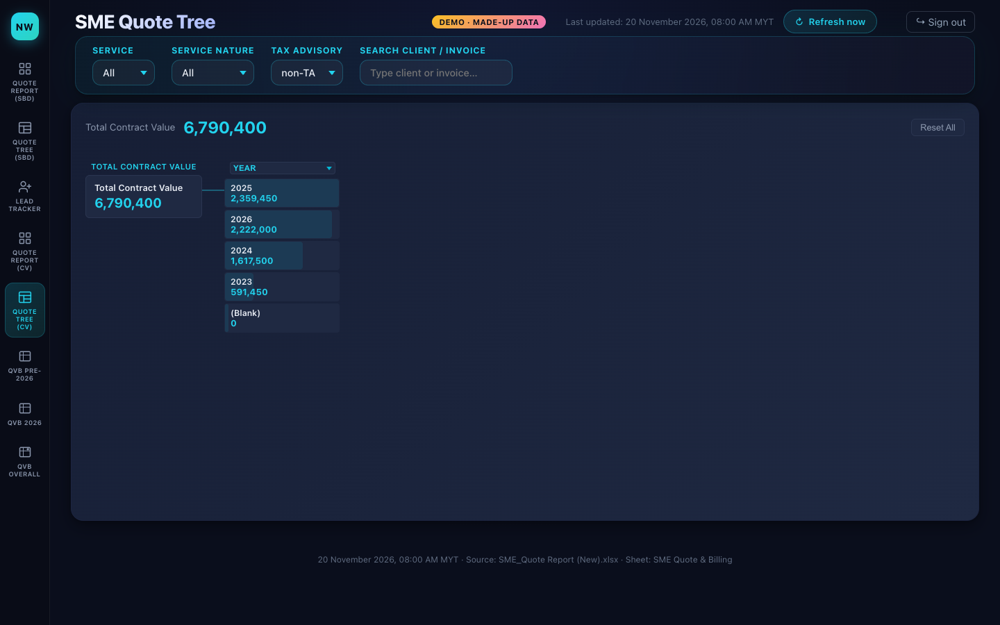

### Quote vs Billing (Before 2026 · 2026 · Overall)

**Answers:** of the work we contracted, how much have we billed and how much is still to bill?

- **Three cards:** CY Contract Value, Billing To Date, Unbilled Balance.
- **Table:** by entity; click an entity to open its agent entities, then agents, then clients.
- **Contract value by industry:** click an industry to filter the table.
- **Filters:** Billing Month (pick months or whole years), Tax Advisory, and a search box for a client name or invoice number.
- The three tabs differ only in the signed-back year they include: before this year, this year, or all.

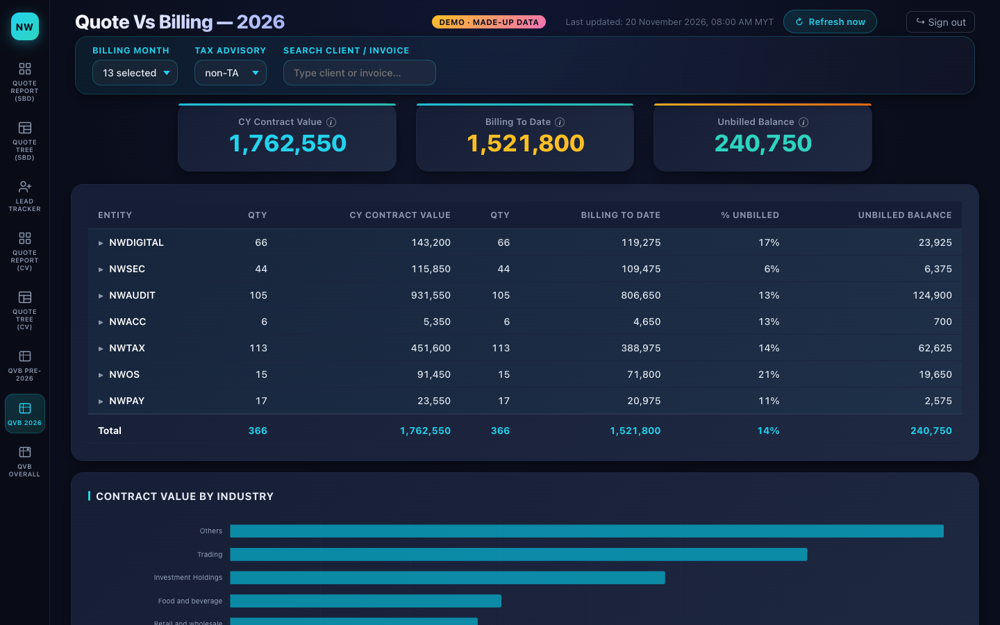
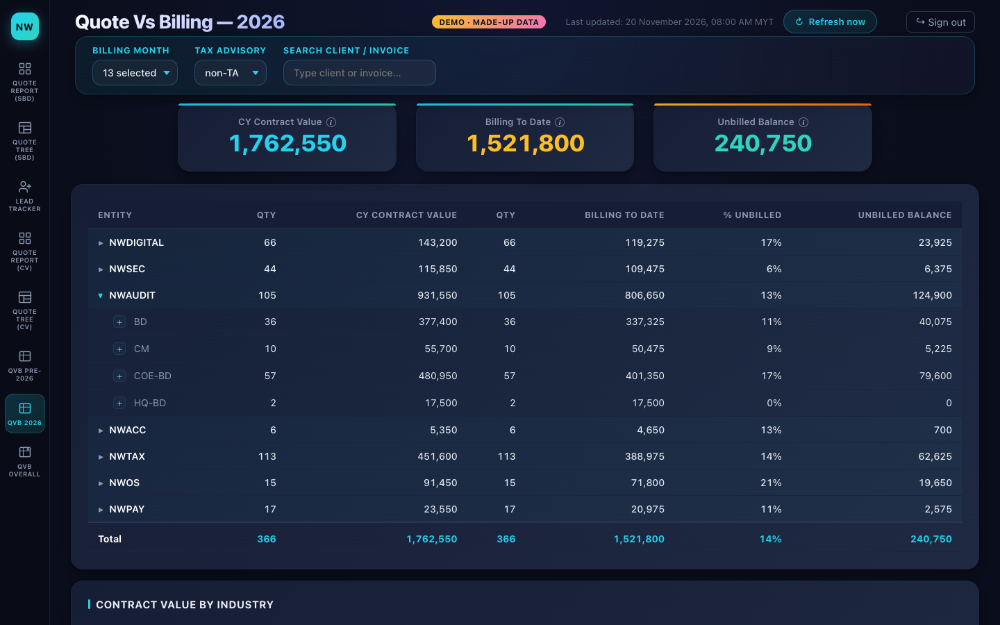

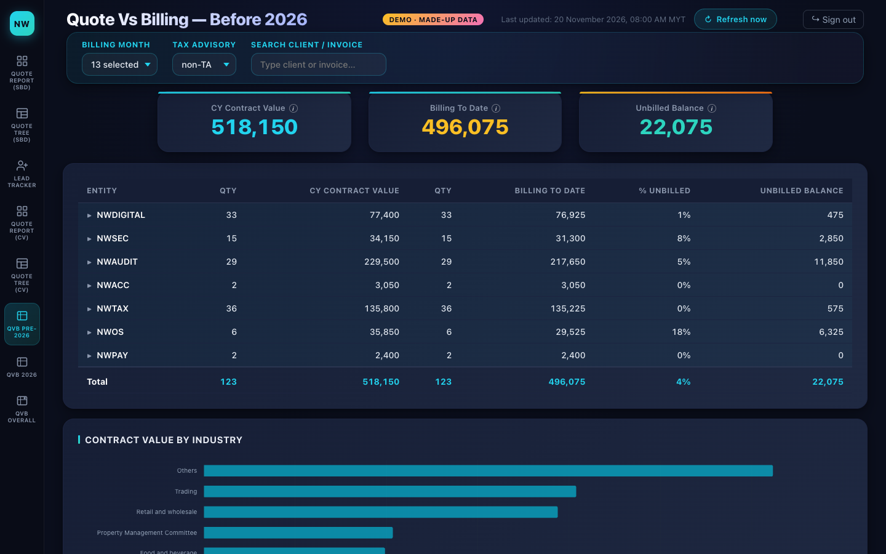

## 4. Definitions

Each card shows its formula behind the ⓘ. In short ("this year" = the year of the latest data):

| Metric | Definition |
|---|---|
| **Acceptance Rate** | accepted quotes ÷ all quotes, counting quotes dated this year **plus** quotes dated earlier but signed back this year, in both the top and the bottom. Distinct quotes, not task lines. |
| **No. Accepted Quote** | distinct accepted quotes dated this year, plus those dated earlier and signed back this year |
| **SBD Value MTD** | sum of SBD value of accepted quotes signed back in the latest month of the Signed Date range |
| **SBD Value YTD** | the same, from January to the end of the Signed Date range |
| **Last year (LY)** | the same calculation for the same months one year earlier |
| **Contract Value YTD** | sum of this year's contract value for quotes signed back this year; contract value sits on one row per quote, so it is never double-counted |
| **No. Accepted Quote (2026)** / **(Carry-over)** | accepted quotes by **quote** date this year / quotes dated in an earlier year but accepted this year |
| **Quote Count (CY CV)** | distinct quotes that carry a contract value this year |
| **CY Contract Value** (Quote vs Billing) | sum of contract value of quotes in scope: those with a contract value, filtered by tab, Billing Month and Tax Advisory. This is the contracted book, not all firm revenue. |
| **Billing To Date** | sum billed against those same quotes only; invoices not tied to a quote with a contract value are not included |
| **Unbilled Balance** | sum of "remaining to bill" (where above zero) for those quotes: contracted work still to invoice, not the firm's receivables |
| **Service Nature** | One-Off for one-off cycles (one-off accounting, backlog, advisory, special audit, …); everything else Recurring |
| **Position group** | Master/Event Lead when no position is recorded; otherwise CoE Staff or Non-CoE Staff |
| **Conversion days** | days from quote to signed back |

## 5. "Why does this number differ from …?"

| Compared with | Why it can differ |
|---|---|
| A count of rows in the register | the dashboard counts **distinct quotes**; one quote can have many task lines |
| Last month's screenshot | quotes are signed back late: a quote from December counts in this year's acceptance rate when it is signed in January |
| Quote vs Billing vs the Quote Report (CV) | Quote vs Billing filters by **billing month** as well; clear the Billing Month filter to compare |
| Total invoicing in the accounting system | Billing To Date covers only invoices tied to quotes with a contract value |
| Another branch's report | this dashboard covers the CoE branch (and its tax-advisory quotes) only |

## 6. When something looks wrong

| Symptom | Likely cause | What to do |
|---|---|---|
| Figures look old | nobody has refreshed since the register changed | press **Refresh now**, wait about a minute |
| "Another refresh is running" | someone else pressed Refresh | wait a minute and reload |
| Refresh fails with a message | a source file was moved, renamed, or a column header changed | the message names the missing file or column; fix the file or tell the dashboard owner |
| Lead counts drop to almost nothing for one channel | that lead file was moved or its sharing changed | tell the dashboard owner; the other channels keep working |
| Quote vs Billing shows zeros | the Billing Month filter is on a period with no billing | choose "All" in Billing Month |
| "Access restricted" after sign-in | you signed in with a personal or non-company account | use **Sign out and try a different account** |
